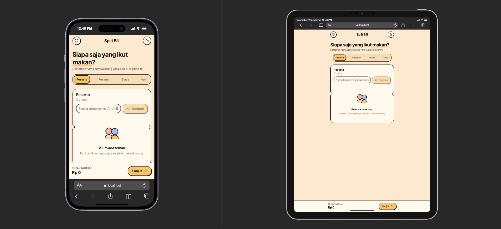

# Split Bill 🧾

Aplikasi web modern untuk menghitung dan membagi tagihan makan bersama secara adil dan transparan, termasuk menu patungan, diskon, biaya service, dan pajak.

Didesain dengan gaya **Soft Neo-Brutalism** dengan layout adaptif untuk mobile dan desktop.

---

## 📸 Dokumentasi Tampilan Aplikasi

### 🖥️ Tampilan Desktop (≥ 1024px)
Dashboard 3 panel yang lega dan sejajar di bagian atas (Peserta, Pesanan, dan Ringkasan) dengan panel ringkasan *sticky* yang mengambang saat halaman di-scroll:


### 📱 Tampilan Mobile & Responsive (< 1024px)
Alur bertahap intuitif menggunakan Stepper horizontal, BottomSheet untuk input pesanan, kartu hitam "Bagianmu", dan Bottom Bar navigasi tetap:



---

## ✨ Fitur Utama

- **Bagi Pesanan Rata & Fleksibel**: Tiap menu dapat diikuti oleh satu orang atau patungan beberapa orang.
- **Biaya Tambahan Lengkap**: Mendukung Diskon, Biaya Service, dan Pajak (PPN) dalam bentuk persentase (%) maupun nominal (Rp). Dilengkapi fitur akordion buka-tutup yang rapi.
- **Perhitungan Adil & Proporsional**: Pembagian diskon, service, dan pajak dihitung secara proporsional berdasarkan subtotal masing-masing orang, dengan pembulatan rupiah otomatis.
- **Format Salin WhatsApp Lengkap**: Sekali klik untuk menyalin seluruh rincian pesanan, subtotal, potongan diskon, pajak, dan tagihan bersih tiap peserta yang siap dibagikan ke grup WhatsApp.
- **Dual Layout Adaptif**:
  - **Mobile (< 1024px)**: Alur bertahap dengan Stepper (Peserta ➔ Pesanan ➔ Biaya ➔ Hasil).
  - **Desktop (≥ 1024px)**: Dashboard 3 panel sejajar yang luas tanpa scrollbar kosong.
- **Mode Gelap / Terang**: Mendukung dark mode mengikuti tema sistem atau tombol toggle.
- **Penyimpanan Lokal**: Otomatis tersimpan di browser via `localStorage` (key `splitbill:v1`) tanpa perlu login.

---

## 🛠️ Tech Stack

- **Framework**: React 18
- **Build Tool**: Vite
- **Styling**: Tailwind CSS v4 (Design tokens berbasis CSS Variables)
- **Icons**: Lucide React
- **Helper**: `clsx` + `tailwind-merge`

---

## 🚀 Menjalankan Project

```bash
# Pasang dependency
npm install

# Jalankan dev server
npm run dev

# Build produksi
npm run build
```
